# Modbux 使用手冊

版本：`2.3.0-icp.2` | [回到中文 README](../../README.md) | [English README](../../README.en.md)

---

## 目錄

1. [安裝與啟動](#1-安裝與啟動)
2. [視窗與版面配置](#2-視窗與版面配置)
3. [Client 模式（Master 主站）](#3-client-模式master-主站)
   - [3.1 連線設定（TCP、RTU、RTU over TCP）](#31-連線設定tcprturtu-over-tcp)
   - [3.2 讀取設定與輪詢（Read / Poll）](#32-讀取設定與輪詢read--poll)
   - [3.3 暫存器表格（Register Grid）](#33-暫存器表格register-grid)
   - [3.4 資料型別、位元組順序與工程值換算](#34-資料型別位元組順序與工程值換算)
   - [3.5 BITMAP 位元面板與燈號設定](#35-bitmap-位元面板與燈號設定)
   - [3.6 Read Configuration 模式與自動分組](#36-read-configuration-模式與自動分組)
   - [3.7 寫入操作（Write Coils / Holding Registers）](#37-寫入操作write-coils--holding-registers)
   - [3.8 掃描工具（Scan Unit ID's / Scan Registers）](#38-掃描工具scan-unit-ids--scan-registers)
   - [3.9 通訊紀錄（Transactions）](#39-通訊紀錄transactions)
   - [3.10 Client 設定檔儲存、載入與清除](#310-client-設定檔儲存載入與清除)
4. [Server 模式（Slave 從站模擬器）](#4-server-模式slave-從站模擬器)
   - [4.1 TCP 與 RTU 伺服器設定、多伺服器實例與 Unit ID](#41-tcp-與-rtu-伺服器設定多伺服器實例與-unit-id)
   - [4.2 布林點位管理（Coils 與 Discrete Inputs）](#42-布林點位管理coils-與-discrete-inputs)
   - [4.3 數值暫存器管理（Input Registers 與 Holding Registers）](#43-數值暫存器管理input-registers-與-holding-registers)
   - [4.4 故障注入規則（Fault Rules）](#44-故障注入規則fault-rules)
   - [4.5 Server 請求紀錄與擷取限制](#45-server-請求紀錄與擷取限制)
   - [4.6 Server 設定檔儲存、載入與清除](#46-server-設定檔儲存載入與清除)
5. [齒輪選單與系統設定（Settings）](#5-齒輪選單與系統設定settings)
6. [JSON 設定檔、專案檔與 MCP 整合](#6-json-設定檔專案檔與-mcp-整合)
   - [6.1 JSON 設定檔與專案檔結構](#61-json-設定檔與專案檔結構)
   - [6.2 MCP 伺服器連線設定（Streamable HTTP 與 stdio）](#62-mcp-伺服器連線設定streamable-http-與-stdio)
   - [6.3 MCP Tools、Resources 與 Prompts 一覽](#63-mcp-toolsresources-與-prompts-一覽)
7. [狀態保存與復原（Persistence & Undo/Redo）](#7-狀態保存與復原persistence--undoredo)
8. [疑難排解（Troubleshooting）](#8-疑難排解troubleshooting)

---

## 1. 安裝與啟動

### 系統需求與安裝方式

| 作業系統 | 安裝套件 | 最低需求與啟動方式 |
| --- | --- | --- |
| **Windows** | `modbux-<version>-x64-setup.exe` | Windows 10/11 (x64)。執行安裝程式；若出現 Windows SmartScreen 提示，點擊 **More info → Run anyway**（其他資訊 → 仍要執行）。 |
| **macOS** | `modbux-<version>-arm64.dmg` / `modbux-<version>-x64.dmg` | macOS 12+（Apple Silicon 選 `arm64`，Intel 選 `x64`）。將 `Modbux.app` 拖曳至 `/Applications`，首次開啟若遭 Gatekeeper 阻擋，可對應用程式按右鍵選擇「打開」，或於終端機執行 `xattr -cr /Applications/Modbux.app`。 |
| **Linux (`.deb`)** | `modbux_<version>_amd64.deb` / `modbux_<version>_arm64.deb` | 執行 `sudo apt install ./modbux_<version>_amd64.deb`，再執行 `modbux`。 |
| **Linux (`.AppImage`)** | `modbux-<version>-<arch>.AppImage` | 執行 `chmod +x modbux-<version>-<arch>.AppImage && ./modbux-<version>-<arch>.AppImage`。 |

### 從原始碼啟動

1. 安裝 Node.js LTS，並執行 `corepack enable`。專案在 `package.json` 的 `packageManager` 指定 Yarn 4.10.3，Corepack 會自動使用該版本。
2. 於專案根目錄執行 `yarn install`。
3. 執行 `yarn dev` 啟動開發視窗，或執行 `yarn build` 編譯主行程（`out/main`）、Preload（`out/preload`）與前端（`out/renderer`）。

### 單一實例鎖定（Single Instance Lock）

Modbux 啟動時會向作業系統請求單一實例鎖定：

- 若已有 Modbux 執行中，第二次啟動會將焦點切回既有的主視窗並結束新行程。
- 在 macOS 上，關閉所有視窗後程式仍駐留於 Dock；點擊 Dock 圖示或再次啟動時會重新建立主視窗。

---

## 2. 視窗與版面配置

主視窗預設尺寸為 `1480 × 1000`（最小 `820 × 800`）。

### 首頁（Home）

啟動後顯示首頁，畫面包含版本號與六項控制元件：


| UI 元件 | 功能說明 |
| --- | --- |
| **Server** | 進入主視窗內的 Server 模式。 |
| **Client** | 進入主視窗內的 Client 模式。 |
| **獨立視窗按鈕**（`Server` 與 `Client` 之間的分叉圖示） | 開啟獨立的 `Server` 視窗（預設 `1400 × 920`），並將主視窗自動切換至 Client 模式。 |
| **Save project** | 將目前 Client 設定與所有 Server 設定匯出為單一 `modbux_project.json` 檔案。獨立 `Server` 視窗開啟期間無法使用。 |
| **Open project** | 載入專案檔（`.json`），取代目前 Client 與所有 Server 設定。Client 連線中若連線參數變更、或獨立 `Server` 視窗開啟期間會拒絕載入。 |
| **Settings**（右上角齒輪圖示） | 進入系統設定頁面（MCP server 設定）。 |

### 雙視窗並排模式（Split Mode）

在首頁點擊 **Server** 與 **Client** 之間的分叉圖示（**Open server in separate window**）即可進入並排模式：

| 主視窗（Client） | 獨立視窗（Server） |
| :---: | :---: |
| 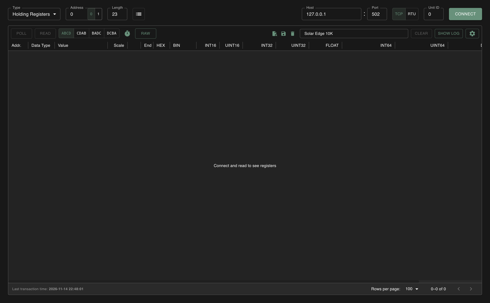 | 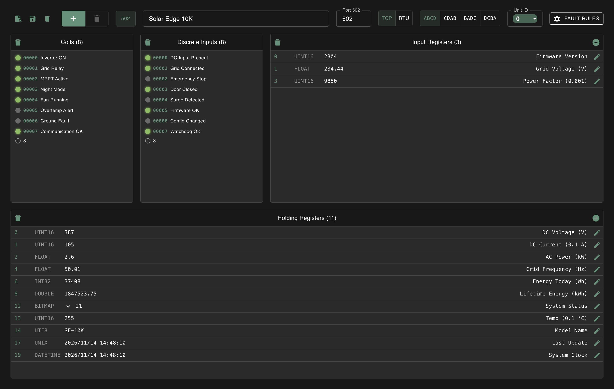 |

- 獨立 `Server` 視窗開啟期間，主視窗固定顯示 Client 畫面，且左上角的回首頁按鈕會自動隱藏。
- 關閉獨立 `Server` 視窗後，主視窗會重新載入 Server 狀態並恢復回首頁按鈕。
- 關閉主視窗時，獨立 `Server` 視窗會一併關閉。

### 版本更新提示列（Update Banner）

啟動時若檢查到 GitHub Releases 有高於目前版本的正式版，視窗頂部會顯示更新提示列：點擊 **Download latest release** 可在瀏覽器開啟下載頁面；點擊 `×` 關閉後，於本次執行期間不再顯示（記錄於 `sessionStorage` 的 `updateBannerDismissed`）。

---

## 3. Client 模式（Master 主站）

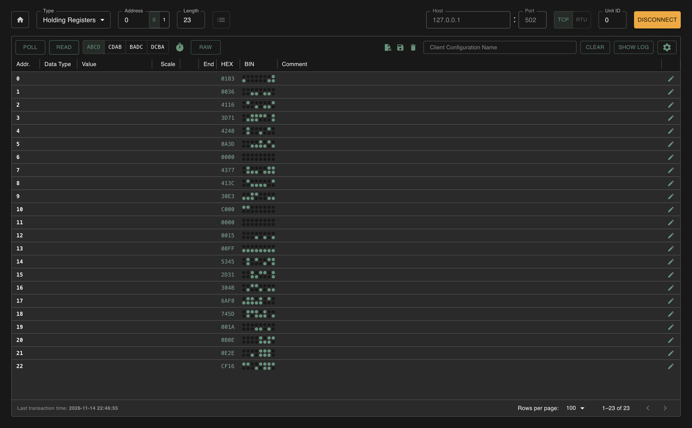

### 3.1 連線設定（TCP、RTU、RTU over TCP）

Client 頂部第一列為連線設定列。未處於斷線狀態（`disconnected`）時，除了 **Unit ID** 之外，其餘連線參數皆會鎖定無法修改。

#### 通訊協定切換與 TCP 設定

| 欄位 / 按鈕 | 範圍 / 選項 | 預設值 | 說明 |
| --- | --- | --- | --- |
| **TCP / RTU** | `ModbusTcp`（或 `ModbusRtuOverTcp`）、`ModbusRtu` | `TCP` | 切換乙太網路或序列埠傳輸。勾選齒輪選單的 **RTU over TCP** 時，**TCP** 按鈕會轉為橘色（warning 色）以提示目前為封裝 RTU 模式。 |
| **Host** | IPv4 位址或主機名稱（不可空白） | `192.168.1.10`（連線本機 Server 時改填 `127.0.0.1`） | 目標 Modbus TCP 伺服器或閘道器位址。空白時欄位標紅且 **Connect** 按鈕停用。 |
| **Port** | `0`–`65535` | `502` | 目標 TCP 連接埠。 |
| **Connect / Disconnect / Cancel** | — | `Connect` | 未連線時顯示 `Connect`；連線建立中顯示橘色 `Cancel`（點擊立即中止連線嘗試）；已連線時顯示紅色外框 `Disconnect`。 |
| **Unit ID** | `0`–`255` | `1` | 目標從站 Unit ID。連線中可隨時修改；非輪詢狀態下修改 Unit ID 會清除表格舊資料（若開啟 `Read configuration` 則重新讀取新 Unit ID 的點位）。 |

#### RTU 序列埠設定

點擊 **RTU** 後，連線列切換為序列埠參數：

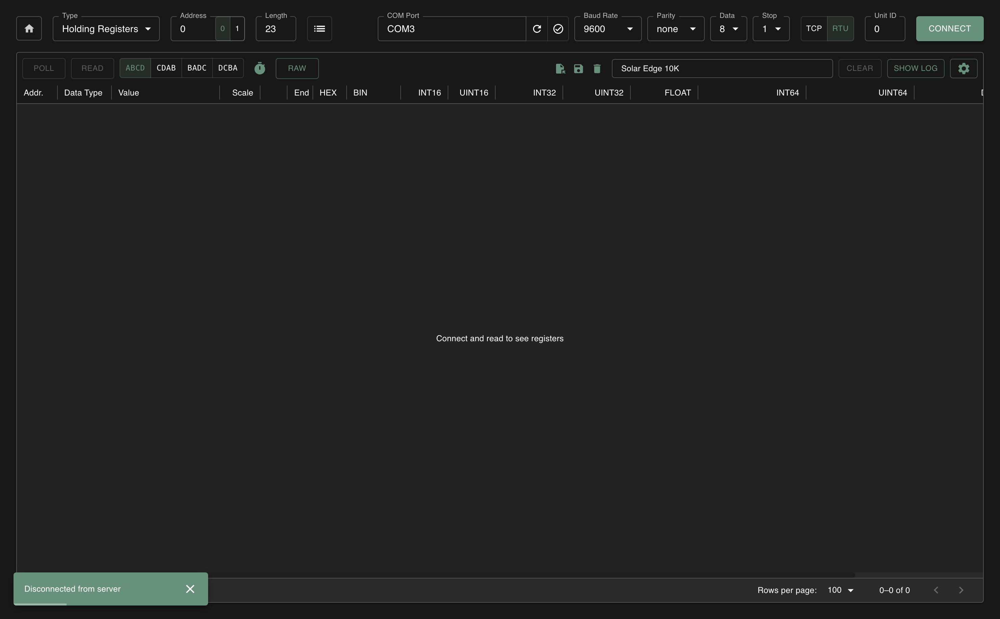

| 欄位 / 按鈕 | 選項 / 範圍 | 預設值 | 說明 |
| --- | --- | --- | --- |
| **COM Port** | 自動偵測清單或手動輸入路徑（如 `COM3`、`/dev/ttyUSB0`） | `COM3` | 下拉選單顯示系統偵測到的序列埠路徑與製造商名稱。空白時標紅並停用 **Connect**。 |
| **Refresh COM ports** | — | — | 重新掃描系統序列埠清單。 |
| **Validate COM port** | — | — | 測試開啟再關閉目前選取的序列埠，並於右下角彈出成功或錯誤訊息。 |
| **Baud Rate** | `1200`, `2400`, `4800`, `9600`, `14400`, `19200`, `38400`, `57600`, `115200` | `9600` | 序列埠鮑率（bps）。 |
| **Parity** | `none`, `even`, `odd`, `mark`, `space` | `none` | 同位元檢查。 |
| **Data** | `5`, `6`, `7`, `8` | `8` | 資料位元數。 |
| **Stop** | `1`, `2` | `1` | 停止位元數。 |

#### RTU over TCP（透明閘道器模式）

在未連線狀態下，點擊第二列右側齒輪按鈕並勾選 **RTU over TCP**：

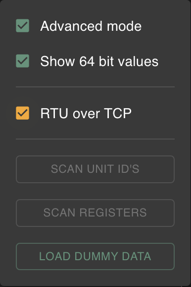

- 啟用後，Client 會將含 16-bit CRC 的完整 Modbus RTU 封包直接寫入 TCP socket（底層使用 `connectTelnet`），而非加上 MBAP 表頭。
- 勾選時 **TCP** 按鈕與齒輪選單中的核取方塊皆顯示為橘色。

#### 自動重連機制（Auto-Reconnect）

當已建立的連線意外中斷時：

1. Client 自動進入 `connecting` 狀態，每 **3 秒**（`3000 ms`）重試連線一次，最多連續重試 **5 次**。
2. 若重連成功且斷線前處於輪詢（Polling）狀態，Client 會在連線穩定 **1 秒**後自動恢復輪詢；連線維持 **10 秒**後重試計數歸零。
3. 若連續 5 次重連失敗，Client 停止重試並切回 `disconnected`。

---

### 3.2 讀取設定與輪詢（Read / Poll）

Client 頂部第二列左側為讀取與輪詢設定列：

| 欄位 / 按鈕 | 選項 / 範圍 | 預設值 | 說明 |
| --- | --- | --- | --- |
| **Type**（Register Type） | `Coils`, `Discrete Inputs`, `Input Registers`, `Holding Registers` | `Holding Registers` | 選擇讀取的暫存器類型（分別對應 FC01、FC02、FC04、FC03）。 |
| **Address** | `0`–`65535`（基底 `1` 時為 `1`–`65536`） | `0` | 讀取起始位址，依位址基底顯示與輸入。開啟 **Read configuration** 時停用。 |
| **位址基底 `0` / `1`**（Address 欄位內） | `0`, `1` | `0` | 切換位址的顯示與輸入基底：`0` 為 PDU 位址，`1` 為 `PDU 位址 + 1`。工具列 **Address**、掃描工具的 **Address** 與表格 **Addr.** 欄位會同步切換，實際送出的 PDU 位址不變。 |
| **Length** | Coils / Discrete Inputs：`1`–`2000`<br>Input / Holding Registers：`1`–`125` | `10` | 單次讀取數量。切換暫存器類型時若超出上限會自動調整至上限值；開啟 **Read configuration** 時停用。 |
| **Read** | — | — | 執行單次讀取。未連線或正在輪詢/掃描時停用。 |
| **Poll** | — | — | 啟動或停止連續輪詢。輪詢期間按鈕顯示呼吸燈動畫。 |
| **Time settings**（時鐘圖示） | `Poll Rate`：`1000`–`10000` ms（步進 `1000` ms / `1` 秒）<br>`Timeout`：`1000`–`10000` ms（步進 `1000` ms / `1` 秒） | `Poll Rate`: `1000` ms（1s）<br>`Timeout`: `5000` ms（5s） | 點擊開啟滑桿彈出視窗，調整輪詢間隔與請求逾時時間（滑桿右側即時顯示目前秒數）。 |

| 暫存器類型選單 | 輪詢與逾時時間設定 |
| :---: | :---: |
| 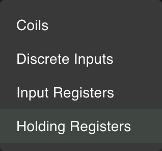 |  |


---

### 3.3 暫存器表格（Register Grid）

暫存器表格根據目前選擇的 **Type**、**Advanced mode** 與 **Show 64 bit values** 動態顯示欄位。後兩者在齒輪選單（More options）中勾選，見[第 5 章](#5-齒輪選單與系統設定settings)；**Show 64 bit values** 需先勾選 **Advanced mode** 才能啟用。

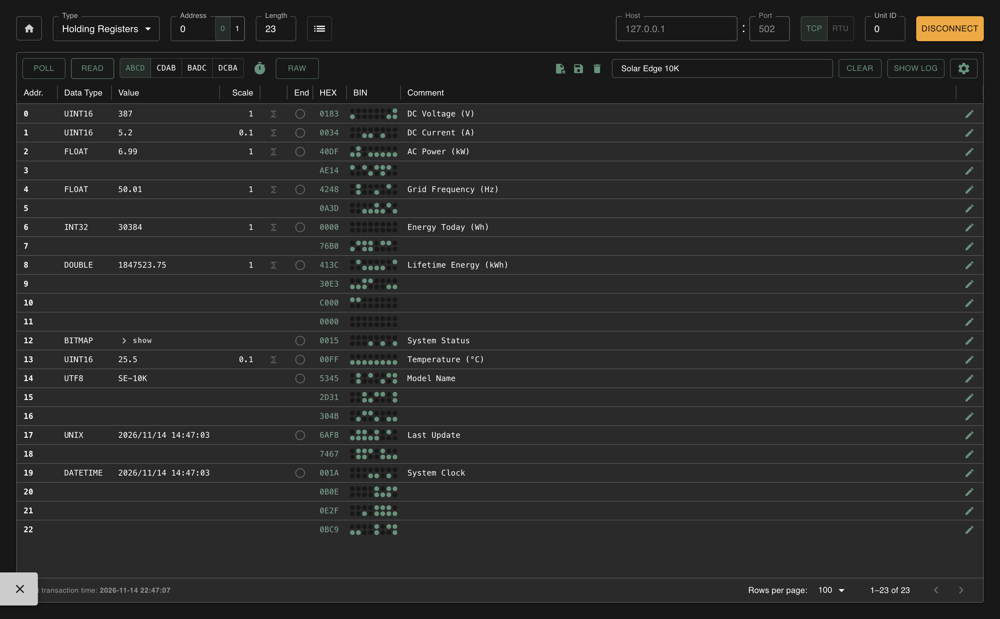

#### 表格欄位一覽

| 欄位標題 | 顯示條件 | 內容與操作說明 |
| --- | --- | --- |
| **Addr.** | 永遠顯示 | 顯示 `PDU 位址 + Address Base`。 |
| **G** | 僅於開啟 **Read configuration** 時顯示 | 自動分組的讀取區塊編號（`1`, `2`, `3`…），以深淺交替底色區分同一次 Modbus 請求讀取的位址群組。 |
| **Bit** | `Coils` 或 `Discrete Inputs` | 顯示布林值 `TRUE`（粗體）或 `FALSE`。 |
| **Data Type** | `Input Registers` 或 `Holding Registers` | 點擊兩下（或選取該儲存格時按空白鍵 / Enter / 下方向鍵）開啟下拉選單，設定該位址的資料型別。未設定時顯示空白。 |
| **Value** | `Input Registers` 或 `Holding Registers` | 顯示依 **Data Type**、位元組順序、**Scale** 與線性內插計算後的工程值。若選擇 `BITMAP` 則顯示展開按鈕（`> show` / `v hide`）；若該群組讀取失敗則以紅字顯示錯誤訊息。 |
| **Scale** | `Input Registers` 或 `Holding Registers` | 點擊兩下編輯數值縮放係數（預設視為 `1`）。僅對數值型別（`INT16`、`UINT16`、`INT32`、`UINT32`、`INT64`、`UINT64`、`FLOAT`、`DOUBLE`）生效。 |
| **Σ**（線性內插欄） | `Input Registers` 或 `Holding Registers` | 點擊 `Σ` 圖示開啟兩點線性內插設定視窗。已設定內插時圖示會以主色高亮顯示。 |
| **End** | `Input Registers` 或 `Holding Registers` | 勾選後強制在該暫存器結尾處切斷 **Read configuration** 的讀取區塊，使下一個點位另起一筆 Modbus 請求。 |
| **HEX** | `Input Registers` 或 `Holding Registers` | 該位址 16-bit word 的 4 位十六進位字串（如 `0183`）。 |
| **BIN** | `Input Registers` 或 `Holding Registers` | 該位址 16-bit word 的 16 位元圓點預覽。 |
| **INT16** | 開啟 **Advanced mode** | 即時預覽該位址解碼為 `INT16` 的值。 |
| **UINT16** | 開啟 **Advanced mode** | 即時預覽該位址解碼為 `UINT16` 的值。 |
| **INT32** | 開啟 **Advanced mode** | 即時預覽從該位址起 2 個暫存器解碼為 `INT32` 的值。 |
| **UINT32** | 開啟 **Advanced mode** | 即時預覽從該位址起 2 個暫存器解碼為 `UINT32` 的值。 |
| **FLOAT** | 開啟 **Advanced mode** | 即時預覽從該位址起 2 個暫存器解碼為 `FLOAT` 的值。 |
| **INT64** | 同時開啟 **Advanced mode** 與 **Show 64 bit values** | 即時預覽從該位址起 4 個暫存器解碼為 `INT64` 的值。 |
| **UINT64** | 同時開啟 **Advanced mode** 與 **Show 64 bit values** | 即時預覽從該位址起 4 個暫存器解碼為 `UINT64` 的值。 |
| **DOUBLE** | 同時開啟 **Advanced mode** 與 **Show 64 bit values** | 即時預覽從該位址起 4 個暫存器解碼為 `DOUBLE` 的值。 |
| **Comment** | 永遠顯示 | 點擊兩下輸入該點位的文字註解。 |
| **寫入欄**（鉛筆圖示） | `Coils` 或 `Holding Registers` | 點擊鉛筆按鈕開啟寫入對話框。未連線或正在輪詢時停用。 |

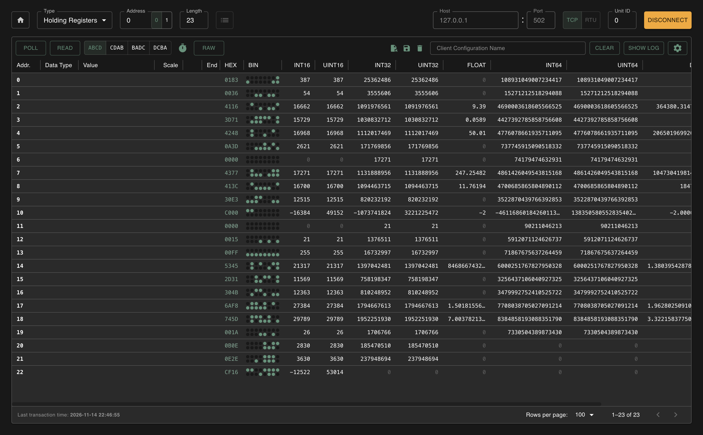

#### 欄位篩選與工具列操作

- 點擊任一欄位標題右側的選單按鈕並選擇 **Filter**，可依條件篩選顯示列；啟用篩選期間，工具列會出現橘色垃圾桶按鈕 **Clear filters**，點擊即可一鍵清除所有篩選條件。
- 表格左下角顯示 `Last transaction time:` 及最近一筆成功通訊的時間（`yyyy-MM-dd HH:mm:ss`，尚無紀錄時顯示 `n/a`）。
- 工具列右側的垃圾桶按鈕 **Clear** 會清空目前表格中的讀取資料（不刪除點位對應設定）。

| 欄位篩選器 | 一鍵清除篩選（Clear filters） |
| :---: | :---: |
| 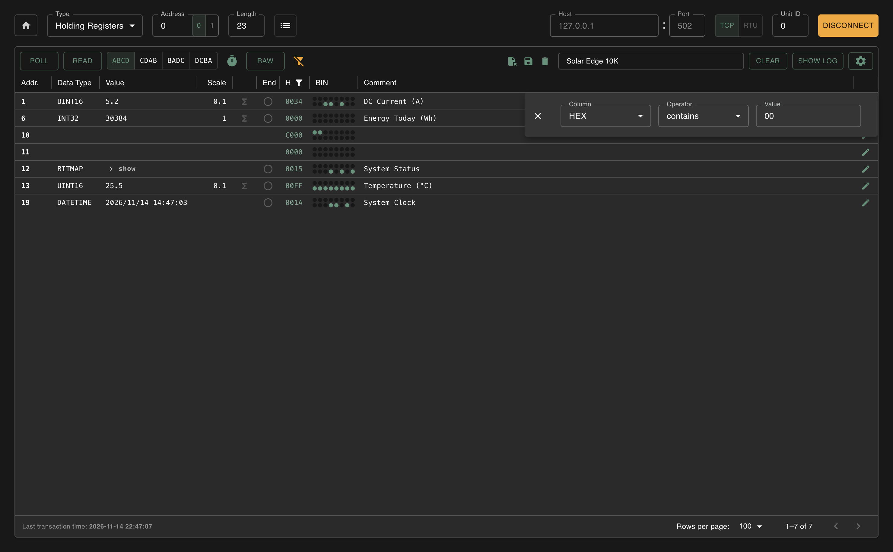 |  |

---

### 3.4 資料型別、位元組順序與工程值換算

#### 12 種資料型別規格表

| 資料型別 | 佔用暫存器數（Words） | 數值範圍 / 編碼格式 | 顯示格式與說明 |
| --- | --- | --- | --- |
| `INT16` | 1（16-bit） | `-32,768` 至 `32,767` | 有號 16 位元整數。 |
| `UINT16` | 1（16-bit） | `0` 至 `65,535` | 無號 16 位元整數。 |
| `BITMAP` | 1（16-bit） | `0` 至 `65,535`（bit `0`–`15`） | 16 位元狀態旗標，可展開檢視與編輯各 bit 註解與燈號。 |
| `INT32` | 2（32-bit） | `-2,147,483,648` 至 `2,147,483,647` | 有號 32 位元整數。受位元組順序影響。 |
| `UINT32` | 2（32-bit） | `0` 至 `4,294,967,295` | 無號 32 位元整數。受位元組順序影響。 |
| `FLOAT` | 2（32-bit） | IEEE 754 單精度浮點數（`±3.4e38`） | 預設四捨五入至小數點後 5 位。受位元組順序影響。 |
| `UNIX` | 2（32-bit） | `0` 至 `4,294,967,295` 秒（1970–2106 UTC） | 自 `1970-01-01 00:00:00 UTC` 起的無號秒數，顯示為 `yyyy/MM/dd HH:mm:ss`（UTC）。受位元組順序影響。 |
| `INT64` | 4（64-bit） | `-9,223,372,036,854,775,808` 至 `9,223,372,036,854,775,807` | 有號 64 位元整數。未縮放且未內插時以精確十進位呈現。受位元組順序影響。 |
| `UINT64` | 4（64-bit） | `0` 至 `18,446,744,073,709,551,615` | 無號 64 位元整數。未縮放且未內插時以精確十進位呈現。受位元組順序影響。 |
| `DOUBLE` | 4（64-bit） | IEEE 754 雙精度浮點數 | 預設四捨五入至小數點後 10 位。受位元組順序影響。 |
| `DATETIME` | 4（64-bit） | IEC 870-5 CP56Time2a 延伸格式（2000–2127 UTC） | Word 0 為年份（自 2000 起算），Word 1 高位元組為月、低位元組低 5 bits 為日、高 3 bits 為星期，Word 2 高位元組為時、低位元組為分，Word 3 為毫秒（`0`–`59999`）。顯示為 `yyyy/MM/dd HH:mm:ss`（UTC）。受位元組順序影響。 |
| `UTF-8` | Client：依群組剩餘長度或預設<br>Server：`1`–`124`（預設 `10`） | 每個暫存器存放 2 個位元組（高位元組在前） | 將 `0x00` 轉為空白字元後以 UTF-8 解碼。不受位元組順序影響。 |

> **多暫存器型別佔用規則**：當某位址設定為佔用 2 或 4 個暫存器的型別時，僅需在起始位址設定 `Data Type`，後續被佔用的位址留空即可（開啟 `Read configuration` 時會隱藏未設定型別的列；未開啟時這些列仍會保留各自的 `HEX`、`BIN` 與進階預覽）。讀取時請確保範圍涵蓋該型別所需的完整暫存器數量，否則區塊末端不足時會導致解碼為 `0`（數值型別）或空白（時間戳記）。

#### 四種位元組順序（Byte Order：`ABCD` / `CDAB` / `BADC` / `DCBA`）

第二列工具列有 **ABCD**、**CDAB**、**BADC**、**DCBA** 四顆切換按鈕，點擊其中一顆即切換位元組順序。滑鼠在按鈕上停留 1 秒會顯示對照表。暫存器類型為 Coils 或 Discrete Inputs 時，這組按鈕隱藏。

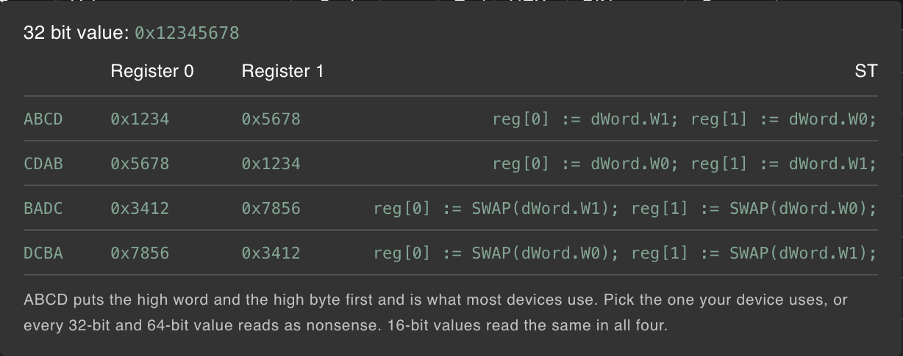

| 代號 | 名稱 | `littleEndian`（Word Swap） | `byteSwap`（Byte Swap） | 32-bit `0x12345678`（Reg 0, Reg 1） | 64-bit `0x0102030405060708`（Reg 0..3） |
| --- | --- | --- | --- | --- | --- |
| **ABCD** | Big-Endian | `false` | `false` | `12 34` \| `56 78` | `01 02` \| `03 04` \| `05 06` \| `07 08` |
| **CDAB** | Little-Endian (Word Swap) | `true` | `false` | `56 78` \| `12 34` | `07 08` \| `05 06` \| `03 04` \| `01 02` |
| **BADC** | Big-Endian Byte Swap | `false` | `true` | `34 12` \| `78 56` | `02 01` \| `04 03` \| `06 05` \| `08 07` |
| **DCBA** | Little-Endian Byte Swap | `true` | `true` | `78 56` \| `34 12` | `08 07` \| `06 05` \| `04 03` \| `02 01` |

- 位元組順序僅套用於 32-bit 與 64-bit 型別（`INT32`、`UINT32`、`FLOAT`、`UNIX`、`INT64`、`UINT64`、`DOUBLE`、`DATETIME`）。
- 16-bit 型別（`INT16`、`UINT16`、`BITMAP`）與 `UTF-8` 在所有位元組順序下解碼結果相同。
- 在已連線且表格有資料時切換位元組順序，Client 會自動觸發一次重新讀取以更新解碼值。

#### 縮放係數（Scale）、線性內插（Linear Interpolation）與 `RAW` 切換

工程值的計算順序為：

1. **原始值解碼**：依 `Data Type` 與位元組順序解出原始數值 $v_{\text{raw}}$。
2. **乘上縮放係數**：$v_{\text{scaled}} = v_{\text{raw}} \times \text{Scale}$（未設定時 $\text{Scale} = 1$）。
3. **套用兩點線性內插**（若有設定 `x1`, `x2`, `y1`, `y2` 且 $x_1 \neq x_2$）：
   $$v_{\text{eng}} = y_1 + \frac{(v_{\text{scaled}} - x_1) \times (y_2 - y_1)}{x_2 - x_1}$$

點擊表格 `Σ` 欄位的按鈕可開啟 **Linear Interpolation** 設定視窗：

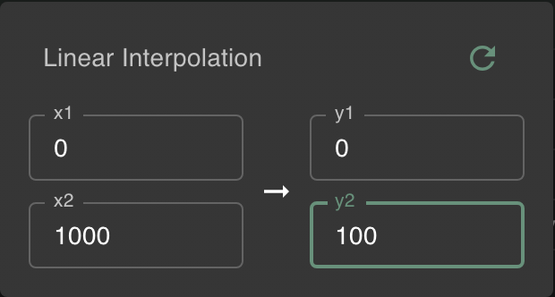

- 四個參數 `x1`、`x2`、`y1`、`y2` 皆填寫完畢後，內插公式立即生效；任一欄留空則不套用內插。
- 點擊工具列上的 **RAW** 按鈕可暫時略過所有 `Scale` 與線性內插，在 `Value` 欄直接顯示未縮放的原始解碼值。

---

### 3.5 BITMAP 位元面板與燈號設定

將暫存器的 `Data Type` 設為 `BITMAP` 後，`Value` 欄會顯示展開按鈕（`> show` / `v hide`），`BIN` 欄則顯示 16 個位元的圓點預覽。點擊 `> show` 會在該列下方展開 16 位元（`00`–`15`）明細面板：

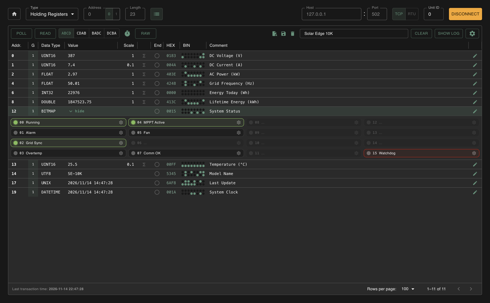

| 操作項目 | 行為說明 |
| --- | --- |
| **檢視位元狀態** | 圓點亮起代表該位元在套用 `Invert` 後為 Active（預設 bit = `1` 為亮起，綠色）。未填寫註解的位元列會半透明淡化顯示。 |
| **點擊圓點直接寫入位元** | 當暫存器類型為 **Holding Registers**、Client 已連線且未在輪詢時，直接點擊任一位元圓點，Client 會將該位元反轉（XOR）並以 **FC06** 將更新後的 16-bit word 寫回設備。 |
| **編輯位元註解** | 點擊位元右側文字（預設顯示 `...`），行內輸入位元說明文字，按 `Enter` 或點擊外部儲存，按 `Escape` 取消。 |
| **位元燈號顏色與反相設定** | 點擊位元列右側的齒輪圖示，開啟設定彈出視窗：<br>• **Invert**：開啟後 bit = `0` 時亮燈、bit = `1` 時熄燈。<br>• **Color**：選擇亮燈顏色為綠色（`success`，預設）、橘色（`warning`）或紅色（`error`）。 |

---

### 3.6 Read Configuration 模式與自動分組

點擊表格工具列的 **Read configuration** 按鈕可切換至點位表讀取模式：

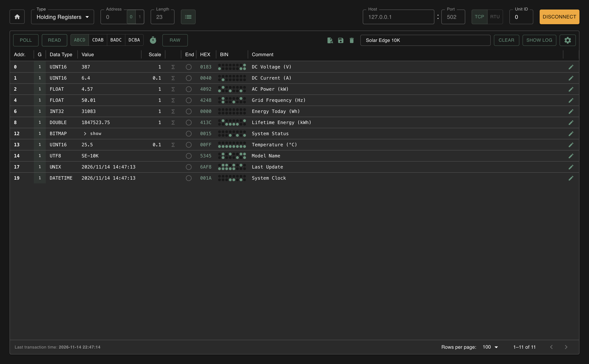

- 啟用時，工具列的 **Address** 與 **Length** 輸入框會停用；Client 改為只讀取目前暫存器類型中已設定 `Data Type`（非 `none`）的位址。
- **自動分組演算法**（`addressGrouping.ts`）：
  1. 依位址由小到大排序所有已設定型別的暫存器，並計算每個點位的結尾位址（`address + width - 1`）。
  2. 若相鄰點位與目前區塊起點的總跨距不超過 **100 個暫存器**（`MAX_BLOCK_SIZE = 100`），且前一個點位未勾選 **End**（`groupEnd`），也非未指定長度的 `UTF-8`，則合併為同一個讀取區塊（共用同一個 **G** 群組編號與一次 Modbus 請求）。
  3. 若點位勾選了 **End**，或跨距超過 100 個暫存器，則從下一個點位起建立新的讀取區塊。
- **單一區塊錯誤隔離**：若某個讀取區塊回傳 Modbus 例外或逾時，僅該區塊內的點位會在 `Value` 欄顯示紅字錯誤訊息，其餘區塊仍正常顯示讀取到的數值。
- 自動分組只用於 `Input Registers` 與 `Holding Registers`。`Coils` 與 `Discrete Inputs` 開啟 **Read configuration** 時，仍讀取工具列 **Address** 與 **Length** 指定的範圍。若 `Input / Holding Registers` 尚未設定任何點位的 `Data Type`，也會改讀工具列範圍。

---

### 3.7 寫入操作（Write Coils / Holding Registers）

當暫存器類型為 **Coils** 或 **Holding Registers**、Client 已連線且未在輪詢時，點擊列尾的鉛筆按鈕開啟寫入對話框。

#### 寫入 Holding Registers（FC06 / FC16）


- 開啟寫入對話框時，若工具列的 **RAW** 處於關閉狀態，Modbux 會自動將其開啟，使表格顯示未縮放的原始值。關閉對話框後不會自動還原，需手動點擊工具列的 **RAW** 切回。
- **數值欄位（`Address <N> value`）輸入的是原始值。** 對話框不套用 `Scale`，也不會反向換算線性內插：位址設定 `Scale = 0.1` 時，要寫入工程值 `12.3`，需輸入 `123`。MCP 工具 `client_write` 可帶入 `scalingFactor` 與內插參數，由工程值換算原始值後寫入，見[第 6.3 節](#63-mcp-toolsresources-與-prompts-一覽)。
- 對話框依目前位元組順序將數值編碼為 1、2 或 4 個 words。`UTF-8` 不能寫入：選擇 `UTF-8` 送出時，Modbux 會顯示 `Modbux cannot write a value as UTF-8` 且不送出請求。
- 輸入數值後，點擊對話框右側的功能碼按鈕即立即送出，沒有另外的送出按鈕：
  - **6**（FC6: Write single register）：僅在 `Data Type` 為 `INT16` 或 `UINT16` 時可用。
  - **16**（FC16: Write multiple registers）：適用於所有可寫入的型別。
- 寫入完成後，Client 自動讀取一次以更新表格。

#### 寫入 Coils（FC05 / FC15）

| FC05 單一 Coil 寫入 | FC15 多筆 Coils 寫入 |
| :---: | :---: |
|  |  |

- 對話框以 **5** / **15** 切換功能碼，按鈕上顯示位址號碼的方塊代表各 Coil：實心填滿為 `TRUE`，外框空心為 `FALSE`，點擊切換。設定完成後點擊 **5** / **15** 右側的上傳圖示按鈕（Write coils）送出。
- **5**（FC5）：只顯示並寫入所點的那一個 Coil。
- **15**（FC15）：顯示並寫入從所點位址到讀取視窗（工具列 **Address** + **Length**）結尾的所有 Coils，沒有可設定的長度欄位。一次最多寫入 1968 個；超過時只寫前 1968 個，並顯示 `One request writes 1968 coils, so the last <N> were left alone`。

---

### 3.8 掃描工具（Scan Unit ID's / Scan Registers）

點擊第二列工具列右側的齒輪按鈕 **More options** 可開啟掃描與測試選單：

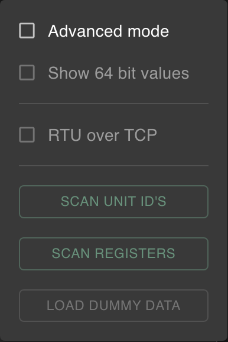

#### Scan Unit ID's（掃描匯流排從站 ID）

點擊 **Scan Unit ID's** 開啟從站掃描對話框：

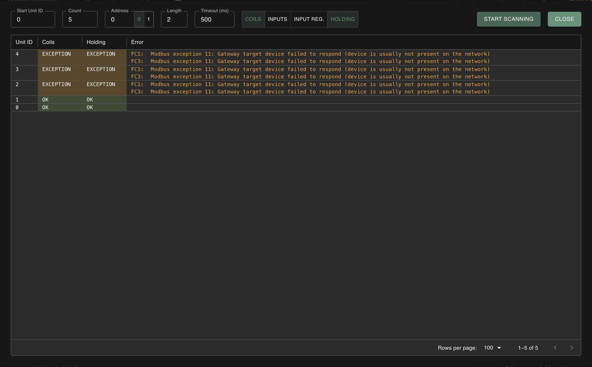

| 欄位 / 按鈕 | 範圍 / 選項 | 預設值 | 說明 |
| --- | --- | --- | --- |
| **Start Unit ID** | `0`–`255` | `0` | 掃描起始 Unit ID。 |
| **Count** | `1`–`256`（超過 `255` 的部分不掃描） | `10` | 掃描的 Unit ID 數量。 |
| **Address** | `0`–`65535` | `0` | 對每個 Unit ID 試讀的起始位址，依位址基底顯示。 |
| **Length** | 僅勾選 Coils / Discrete Inputs 時上限為 `2000`；包含 Input / Holding Registers 時上限為 `125` | `2` | 每次試讀的長度。 |
| **Timeout (ms)** | `100`–`10000` ms | `500` | 單次請求逾時毫秒數。 |
| **Register Types** | 四種暫存器類型（至少勾選一項） | `Holding Registers` | 對每個 Unit ID 依序測試勾選的暫存器類型。 |
| **Start Scanning / Stop Scanning** | — | — | 開始或中途停止掃描。 |

掃描結果表格針對每個已測試的 Unit ID 與暫存器類型顯示三種狀態標籤：

- **OK**（綠底）：設備正常回傳資料。
- **EXCEPTION**（橘底，滑鼠懸停顯示原始例外訊息）：設備回傳 Modbus 例外碼，代表該 Unit ID 存在於匯流排上但拒絕該位址或功能碼。
- **NO REPLY**（灰字）：請求逾時無回應。

#### Scan Registers / Scan TRUE Bits（掃描非零暫存器或 TRUE 位元）

點擊齒輪選單的 **Scan Registers**（當類型為 `Coils` 或 `Discrete Inputs` 時按鈕名稱為 **Scan TRUE Bits**）會在工具列上方展開掃描控制列：

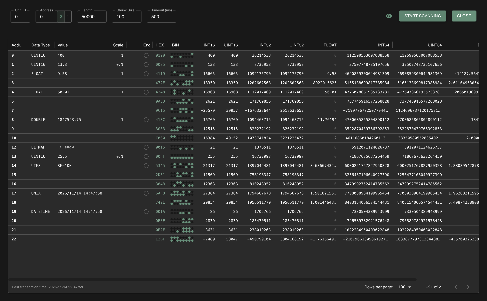

| 欄位 / 按鈕 | 範圍 / 預設值 | 說明 |
| --- | --- | --- |
| **Unit ID** | `0`–`255`（同目前 Unit ID） | 掃描目標 Unit ID。 |
| **Address** | `0`–`65535`（預設 `0`） | 掃描起始 PDU 位址。 |
| **Length** | 預設 `10000`（`Address + Length <= 65536`） | 掃描位址總數。 |
| **Chunk Size** | Coils/DI：`1`–`2000`<br>Registers：`1`–`125`（預設 `100`） | 單筆 Modbus 讀取請求涵蓋的位址數。 |
| **Timeout (ms)** | `100`–`10000` ms（預設 `500`） | 單筆請求逾時毫秒數。 |
| **隱藏/顯示表格按鈕**（眼睛圖示） | 預設開啟 | 掃描期間是否即時渲染下方表格；關閉可降低大量命中時的畫面更新負載。 |
| **Start Scanning / Stop Scanning** | — | 啟動或停止掃描。掃描進行期間，眼睛圖示左側會即時顯示已發現的非零暫存器或 `TRUE` 位元數量（`Found: N`）。 |

---

### 3.9 通訊紀錄（Transactions）

點擊工具列的 **Show Log**（展開後顯示為 **Hide Log**）可切換顯示通訊紀錄表格：

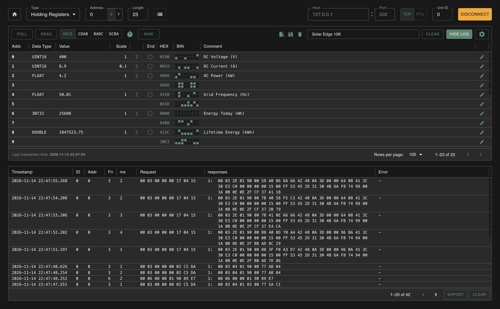

- 系統於記憶體中保留最新 **1,000 筆**（`MAX_TRANSACTIONS = 1000`）Modbus 交易紀錄。
- **欄位說明**：

| 欄位標題 | 內容說明 |
| --- | --- |
| **Timestamp** | 交易記錄時間（`yyyy-MM-dd HH:mm:ss.SSS`）。 |
| **ID** | 目標 Unit ID。 |
| **Addr** | 請求起始 PDU 位址。 |
| **Fn** | Modbus Function Code（如 `3`, `4`, `6`, `16`）。 |
| **ms** | 從送出請求至收到回應（或發生逾時）的耗時毫秒數（`durationMs`）。 |
| **Request** | 送出的原始請求封包十六進位字串（含 Unit ID、Function Code、資料與 CRC，不含 TCP MBAP 表頭）。 |
| **responses** | 收到的原始回應封包十六進位字串（多筆時會依序編號列出）。 |
| **Error** | 逾時或 Modbus 例外訊息（正常時顯示 `-`）。 |

- 點擊 **Export** 會匯出為 `transaction_log_<yyyyMMdd_HHmmss>.csv`，包含上表的所有欄位。
- 點擊 **Clear** 清空通訊紀錄。

---

### 3.10 Client 設定檔儲存、載入與清除

表格工具列最右側提供設定名稱與檔案管理按鈕：

| 元件 | 功能說明 |
| --- | --- |
| **Client Configuration Name** 文字框 | 設定目前 Client 組態名稱（最多 32 字元），會一併寫入匯出的 JSON 檔名與內容。 |
| **Save**（磁碟片圖示） | 將目前 Client 名稱、連線設定（`connectionConfig`）、讀取設定（`registerConfig`，含位元組順序）與四種暫存器類型的點位對應表（`registerMapping`）匯出為 `.json` 檔案。 |
| **Open**（資料夾圖示） | 選擇並載入 Client JSON 設定檔（支援 v0、v1、v2、v3 格式自動遷移）。若 Client 處於連線中且檔案內的連線參數（協定、Host、Port、RTU 參數）與目前不同，系統會拒絕套用那些連線參數並顯示提示。 |
| **Clear**（垃圾桶圖示） | 彈出 **Clear Client Configuration** 確認對話框；點擊 **Clear** 會清空所有點位對應表與組態名稱，並關閉 **Read configuration**。 |

---

## 4. Server 模式（Slave 從站模擬器）

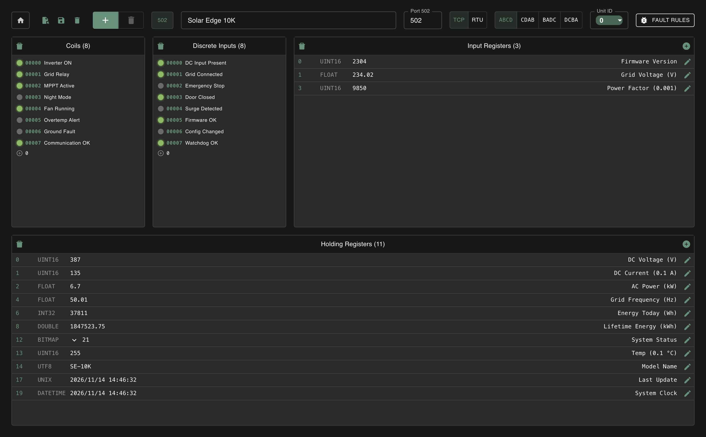

### 4.1 TCP 與 RTU 伺服器設定、多伺服器實例與 Unit ID

#### TCP 與 RTU 模式切換與多台 TCP 伺服器

Server 頂部工具列可切換 **TCP** 與 **RTU** 模式：

- **TCP 模式（支援最多 10 台獨立伺服器）**：
  - 預設包含一台主伺服器（`MAIN_SERVER_UUID`，預設監聽 Port `502`，不可刪除）。
  - 點擊左上角 `+` 按鈕可新增額外的 TCP 伺服器實例，最多同時執行 **10 台**（達到 10 台時 `+` 按鈕隱藏）。
  - 新增伺服器時，系統會從 Port `502` 起尋找第一個未被其他 Server 佔用、且非 MCP 專用埠（`15502`）的可用連接埠自動綁定。
  - 點擊伺服器按鈕（顯示連接埠號，如 `502`、`503`）可切換目前編輯的伺服器；選取非主伺服器時，右側會顯示紅色垃圾桶按鈕可刪除該伺服器並釋放連接埠。
- **RTU 模式**：
  - 切換至 **RTU** 時，系統會停止所有 TCP 監聽器，並以主伺服器（`MAIN_SERVER_UUID`）的暫存器資料透過指定的序列埠提供服務。
  - 工具列顯示 **COM Port**、重新整理按鈕、USB 狀態指示燈（綠色 USB 圖示代表監聽中，點擊可重啟 RTU 伺服器）、**Baud Rate**、**Parity**、**Data** 與 **Stop**。

#### Server 頂部設定欄

| 欄位 / 按鈕 | 範圍 / 選項 | 預設值 | 說明 |
| --- | --- | --- | --- |
| **Open / Save / Clear** | — | — | 載入、匯出或清空目前選取伺服器的設定與所有 Unit ID 暫存器。 |
| **Port**（僅 TCP 模式） | `1`–`65535`（輸入欄可輸入 `0`–`65535`） | `502` | 修改目前 TCP 伺服器的監聽埠（輸入後離開焦點生效）。不可與其他伺服器重複，且不可使用 `15502`。 |
| **Unit ID** | `0`–`255` | `0` | 切換目前檢視與編輯的 Unit ID 點位表。下拉選單中已設定任何點位的 Unit ID 會以主色高亮標示。 |
| **Server Name** | 字串 | 空字串 | 目前伺服器的識別名稱。 |
| **Byte Order** | `ABCD`, `CDAB`, `BADC`, `DCBA` | `ABCD` | 設定該伺服器編碼 32-bit 與 64-bit 暫存器時的位元組順序。切換時會立即重新編碼並同步所有 Unit ID 的暫存器。 |
| **Fault rules** | — | `Fault rules` | 開啟故障注入規則對話框。當該伺服器設有規則時，按鈕轉為橘色並顯示規則數量（如 `Fault rules (2)`）。 |

#### 未設定 Unit ID 與 RTU 廣播（Unit ID 0）行為

- **讀取已託管 Unit ID（Hosted Unit）的未定義位址**：當某個 Unit ID 至少已建立一個點位時，即視為「已託管」。在有效位址範圍（`0`–`65535`）內讀取該 Unit ID 尚未定義的位址，會回傳 `0`（暫存器）或 `false`（位元）。
- **請求未託管的 Unit ID（Un-hosted Unit ID）**：
  - **TCP 模式**：回傳 Modbus 例外碼 **11**（`Gateway Target Device Failed to Respond`）。
  - **RTU 模式**：保持靜默不回應（`no_response`），避免在共用 RS-485 匯流排上與其他實體從站發生封包碰撞。
- **RTU 廣播位址（Unit ID `0`）**：
  - 在 **RTU 模式**下，Unit ID `0` 為 Modbus 廣播位址：主站對 Unit ID `0` 發送寫入請求時，Server 會將數值寫入該伺服器上**所有已託管的 Unit ID**，且依規範不回傳任何封包；對 Unit ID `0` 發送讀取請求則不回應。
  - 在 **TCP 模式**下，Unit ID `0` 視為一般可讀寫的獨立 Unit ID（常見於直連 TCP 設備）。

---

### 4.2 布林點位管理（Coils 與 Discrete Inputs）

畫面左側兩個面板分別為 **Coils** 與 **Discrete Inputs**（面板標題括號內顯示目前已建立的點位數量，點擊標題可摺疊或展開面板）：

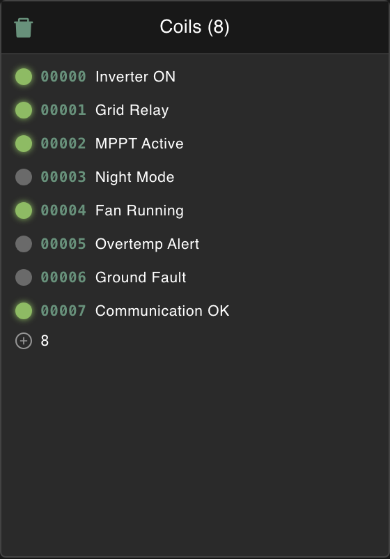

1. **新增點位**：在清單底部的輸入框輸入位址（`0`–`65535`）並按 `Enter` 或點擊 `+`。若輸入的位址已存在，會自動跳至下一個空閒位址並遞增預填值。
2. **切換 ON / OFF**：點擊位址左側的圓點即可在 `true`（綠燈發光）與 `false`（灰色）之間切換。
3. **編輯註解**：點擊位址右側的註解文字（未設定時顯示 `...`）可直接行內輸入註解，按 `Enter` 儲存。
4. **刪除單一點位或全部點位**：滑鼠移至該列右側點擊垃圾桶圖示刪除單一點位；點擊面板標題列左側的垃圾桶圖示清空該 Unit ID 下所有 Coils 或 Discrete Inputs。

---

### 4.3 數值暫存器管理（Input Registers 與 Holding Registers）

畫面右側兩個面板分別為 **Input Registers** 與 **Holding Registers**。點擊面板標題列右側的 `+` 按鈕開啟 **Add Input Register** / **Add Holding Register** 對話框；點擊既有暫存器列右側的鉛筆按鈕則開啟 **Edit** 對話框。

#### 固定值（Fixed）與隨機產生器（Generator）

| 固定值模式（Fixed） | 產生器模式（Generator） |
| :---: | :---: |
| 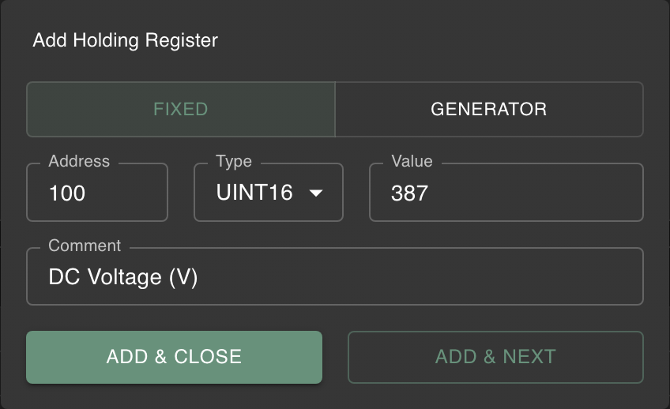 | 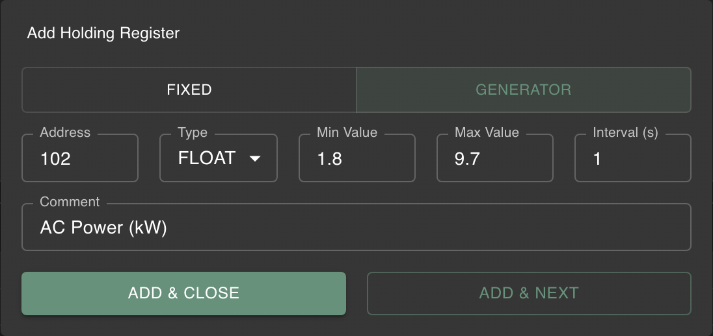 |

| 欄位 / 按鈕 | 顯示條件與範圍 | 說明 |
| --- | --- | --- |
| **Fixed / Generator** | 除 `UTF-8` 與 `BITMAP` 外皆顯示 | 選擇固定數值或定時動態更新。`UTF-8` 與 `BITMAP` 強制為 `Fixed`。 |
| **Address** | `0`–`65535` | 起始 PDU 位址。若與既有暫存器重疊會標紅並顯示 `In use`；若起始位址加上型別寬度超出 `65535` 則顯示 `Data type does not fit at this address`。 |
| **Data Type** | 12 種資料型別 | 選擇暫存器編碼型別。 |
| **Value** | 數值型別 + `Fixed` | 輸入符合該型別範圍的固定數值。 |
| **Min Value / Max Value** | 數值型別 + `Generator` | 產生器隨機數值的下限與上限（含小數，針對整數型別會取整）。 |
| **Interval (s)** | `Generator` 模式（`1`–`3600` 秒） | 產生器每隔幾秒更新一次數值。 |
| **String Value / Registers** | `UTF-8` 型別（長度 `1`–`124`，預設 `10`） | 輸入字串內容與佔用的暫存器數量（每暫存器 2 bytes，下方即時顯示 `<目前已用> / <上限> bytes`）。 |
| **Date & Time / UTC** | `UNIX` 或 `DATETIME` + `Fixed` | 選擇固定時間；點擊 **UTC** 按鈕切換以本機時區或 UTC 顯示選擇器（底層暫存器永遠以 UTC 編碼）。 |
| **Comment** | 任意文字 | 暫存器註解。 |
| **Add & Close / Add & Next** | 新增模式 | **Add & Close** 新增後關閉視窗；**Add & Next** 新增後保留型別設定並自動跳至下一個可用位址。編輯模式下顯示 **Submit Change** 與 **Remove**（當表單未修改時可點擊刪除該暫存器）。 |

#### 字串（UTF-8）與時間（UNIX / DATETIME）設定畫面

| UTF-8 字串暫存器 | UNIX 固定時間（含 UTC 切換） |
| :---: | :---: |
|  | 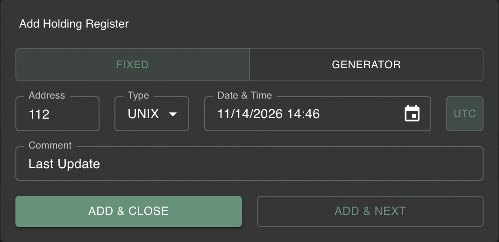 |

| UNIX 系統時間產生器 | DATETIME 系統時間產生器 |
| :---: | :---: |
| 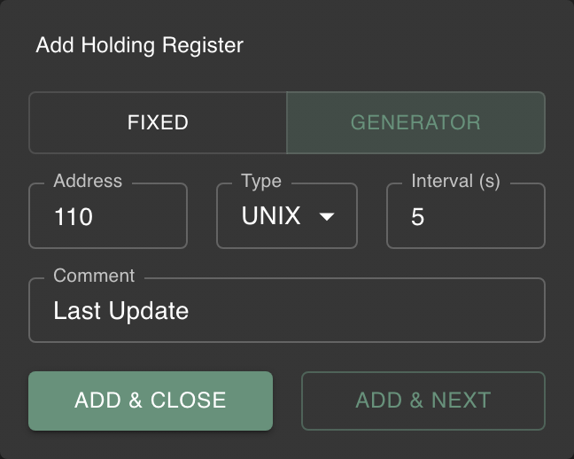 | 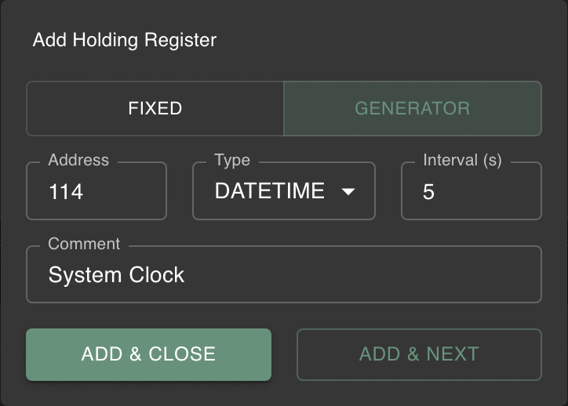 |

> **時間產生器行為**：當 `UNIX` 或 `DATETIME` 選擇 **Generator** 模式時，不需設定 Min/Max；Server 會依 **Interval (s)** 秒數定期讀取本機系統時鐘（`Date.now()`）並寫入暫存器。

#### Server 端 BITMAP 展開編輯

對於 `Data Type` 為 `BITMAP` 的暫存器，點擊該列位址旁的展開箭頭即可在 Server 面板內展開 `00`–`15` 共 16 個位元：


- 點擊任一位元圓點可即時翻轉該 bit 並更新暫存器數值。
- 點擊位元旁的 `...` 可行內編輯該 bit 的文字註解，儲存設定檔時會一併寫入該暫存器的 `bitMap` 欄位。

---

### 4.4 故障注入規則（Fault Rules）

點擊 Server 頂部工具列的 **Fault rules** 按鈕可開啟故障注入規則管理對話框，模擬現場設備離線、忙碌、拒絕寫入或回應緩慢等異常情境：

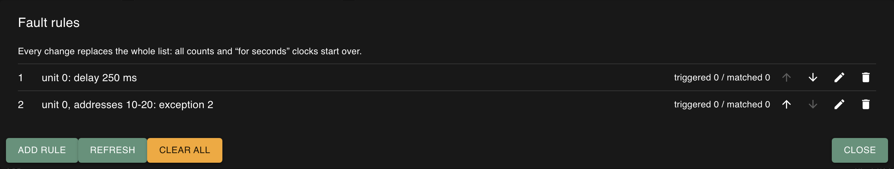

#### 規則匹配邏輯與優先順序

- 每台伺服器最多可設定 **32 條**（`MAX_FAULT_RULES = 32`）故障規則，依清單順序（`1`, `2`, `3`…）由上而下比對。
- 當請求進入時，**第一條所有條件皆符合**的規則即決定該請求的行為；後續規則不會再看到該請求。
- 若第一條符合的規則設有 **Every Nth match**（例如每 3 次觸發 1 次），則未觸發的那幾次請求會**正常回應**，且不會往下交給後面的規則。

#### 規則欄位說明

| 類別 | 欄位名稱 | 範圍 / 選項 | 說明 |
| --- | --- | --- | --- |
| **匹配條件** | **Unit ID** | `0`–`255`（留空代表任意 Unit ID） | 限制僅比對特定 Unit ID。 |
| **匹配條件** | **Register type** | `Any`, `coils`, `discrete_inputs`, `input_registers`, `holding_registers` | 限制比對特定暫存器類型。 |
| **匹配條件** | **Direction** | `Any`, `Read`, `Write` | 限制比對讀取或寫入請求。 |
| **匹配條件** | **Address from / Address to** | `0`–`65535`（兩端皆包含；留空代表任意位址） | 只要請求涵蓋的位址範圍與 `[from, to]` 有任何交集即視為符合。兩欄須同時填寫或同時留空，且 `from <= to`。 |
| **故障動作** | **Exception** | 例外碼 `1`–`255`（預設 `6` Server Device Busy） | 回傳指定的 Modbus 例外碼；若是寫入請求，**不會**寫入任何數值。 |
| **故障動作** | **No response** | — | 完全不回傳封包（讓主站逾時）；若是寫入請求，**不會**寫入任何數值。 |
| **故障動作** | **Delay** | `1`–`30000` ms（預設 `500` ms） | 請求到達當下照常讀寫暫存器，但將回應封包延遲指定毫秒數後才送出。清除或修改規則不會取消已在等待送出的延遲回應（停止或刪除伺服器才會取消）。 |
| **觸發控制** | **Every Nth match** | 正整數（`>= 1`，留空代表每次符合皆觸發） | 每符合 N 次才觸發 1 次故障動作。 |
| **觸發控制** | **For seconds** | 大於 `0`、最多 `86400` 秒，可輸入小數（如 `0.5`；留空代表持續有效直到手動移除） | 規則儲存後經過指定秒數即自動從清單移除。清單列會顯示剩餘秒數（`<N> s left`）。 |

#### 清單操作與生命週期

- 每條規則列顯示 `triggered <觸發次數> / matched <符合次數>`；點擊對話框底部的 **Refresh** 可更新最新計數與剩餘秒數。
- 可透過每列右側的上下箭頭（`Move up` / `Move down`）、鉛筆（`Edit`）與垃圾桶（`Delete`）調整順序、修改或刪除規則，或點擊 **Clear all** 清空全部規則。
- **TCP 與 RTU 的差異**：在 RTU 模式下，針對未託管（Un-hosted）Unit ID 的請求會直接靜默忽略，不會進入故障規則比對；RTU 廣播（Unit ID `0`）永遠不回傳封包，但若命中 `Exception` 或 `No response` 規則會阻止該筆廣播寫入。
- **生命週期**：故障規則僅存於主行程記憶體中，不會寫入設定檔或 `localStorage`；重啟程式、刪除伺服器或載入 Server 設定檔 / 專案檔時皆會自動清除該伺服器的故障規則。

---

### 4.5 Server 請求紀錄與擷取限制

每台 Server 在主行程記憶體中會記錄最新 **1,000 筆**（`SERVER_REQUEST_LOG_LIMIT = 1000`）收到的主站請求，可透過 MCP 工具 `server_get_requests` 查詢（UI 畫面不直接顯示此清單）。

#### 每筆請求紀錄欄位

- `timestamp`：收到請求的毫秒時間戳記（Epoch ms）。
- `uuid`：伺服器 UUID。
- `unitId`：請求封包攜帶的 Unit ID（RTU 模式下包含廣播位址 `0`）。
- `direction`：`'read'` 或 `'write'`。
- `registerType`：`coils`、`discrete_inputs`、`input_registers` 或 `holding_registers`。
- `address` 與 `count`：起始 PDU 位址與數量。
- `outcome`：`'ok'`、`'exception'`（附帶 `exceptionCode`）或 `'no_response'`。
- `values`：寫入請求攜帶的數值或布林陣列（讀取請求無此欄位）。
- `fault`：若該請求是由故障規則決定，記錄 `{ rule: <規則索引(0-based)>, delayMs?: <毫秒> }`。

#### 請求紀錄看不到的封包（擷取限制）

由於請求紀錄與故障規則皆運作於 `modbus-serial` 的 `IServiceVector` 層，**由 `modbus-serial` 底層協定解析器直接攔截並回覆的封包不會進入 Vector，因此不會出現在請求紀錄中，也不會觸發故障規則**：

1. **數量為 0 的請求**：Function Code `1`、`2`、`3`、`4`、`15` 請求數量為 `0` 時，`modbus-serial` 直接攔截（注意：FC16 數量為 `0` 時 `modbus-serial` 送出例外碼 2 後仍會呼叫 `setRegisterArray([])`，因此 FC16 數量 0 會被記錄為 `exception` 2）。
2. **超出協定單筆數量上限的讀取請求**：FC1 / FC2 數量大於 `2040`，或 FC3 / FC4 數量大於 `127` 時，因回應的位元組長度欄位無法容納，`modbus-serial` 直接回傳例外碼 4（不會進入 Vector 也不留紀錄）。
3. **未實作的 Function Code**：例如 FC7、FC43 等 Vector 未註冊存取器的功能碼，`modbus-serial` 直接回傳例外碼 1。
4. **長度不合法的封包**：位元組長度與表頭或數量不符的異常封包（不回應且不記錄）。
5. **RTU CRC 錯誤的特殊行為**：`modbus-serial` 的 RTU Server 處理器在收到封包時會重新計算並覆寫緩衝區末端的 CRC，而未拒絕壞 CRC 的封包；因此 CRC 錯誤的 RTU 封包若長度與功能碼合法，仍會進入 Vector 被記錄及套用故障規則。

---

### 4.6 Server 設定檔儲存、載入與清除

Server 頂部工具列左側提供三個檔案管理按鈕：

| 按鈕 | 功能說明 |
| --- | --- |
| **Open**（資料夾圖示） | 載入 Server JSON 設定檔（支援 v0–v4 自動遷移）並取代目前選取伺服器的設定，同時清除該伺服器的故障規則。 |
| **Save**（磁碟片圖示） | 將目前選取伺服器的名稱、連接埠、位元組順序與所有 Unit ID（`0`–`255`）的暫存器匯出為 `.json` 檔案（格式版本 v4）。 |
| **Clear**（垃圾桶圖示） | 清空目前選取伺服器的所有 Unit ID 點位與故障規則，並將 Unit ID 切回 `0`。 |

---

## 5. 齒輪選單與系統設定（Settings）

### Client 齒輪選單（More options）

在 Client 畫面點擊第二列右側齒輪按鈕（More options）開啟選單，項目由上而下為：

| 選單項目 | 顯示 / 啟用條件 | 功能說明 |
| --- | --- | --- |
| **Advanced mode** | 暫存器類型為 Input / Holding Registers 時顯示 | 勾選後表格加入 `INT16`、`UINT16`、`INT32`、`UINT32`、`FLOAT` 預覽欄。 |
| **Show 64 bit values** | 同上；須先勾選 **Advanced mode** | 勾選後表格再加入 `INT64`、`UINT64`、`DOUBLE` 預覽欄。 |
| **RTU over TCP** | 未連線且協定非純 RTU | 切換 `ModbusTcp` 與 `ModbusRtuOverTcp` 協定。 |
| **Scan Unit ID's** | 已連線且未在輪詢/掃描 | 開啟 Unit ID 掃描對話框。 |
| **Scan Registers** / **Scan TRUE Bits** | 已連線且未在輪詢/掃描 | 展開非零暫存器或 `TRUE` 位元掃描工具列。 |
| **Load Dummy Data** | 未連線 | 依工具列目前的 **Address** 與 **Length** 範圍，在表格中填入測試資料，供離線測試資料型別解碼、縮放與篩選。 |

清除欄位篩選的 **Clear filters** 按鈕位於表格工具列，見[第 3.3 節](#33-暫存器表格register-grid)。

### 首頁系統設定（Settings — MCP server）

從首頁右上角點擊齒輪按鈕 **Settings** 進入系統設定畫面：

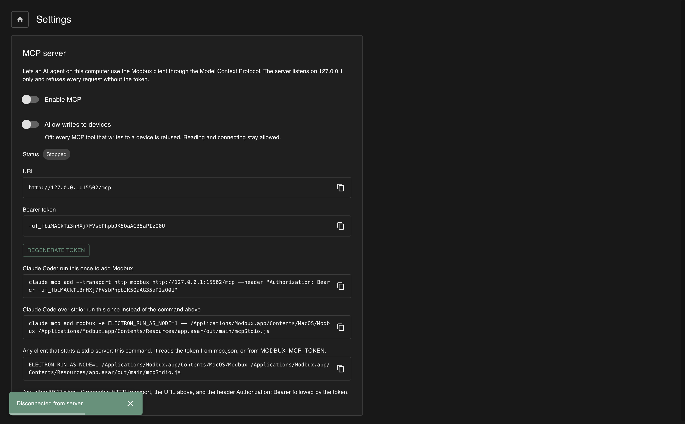

| 設定項目 / 元件 | 預設值 | 功能說明 |
| --- | --- | --- |
| **Enable MCP** | 關閉（`false`） | 啟用或停用內建的 MCP HTTP 伺服器（`127.0.0.1:15502`）。設定立即寫入 `<userData>/mcp.json`，下次啟動時自動依此狀態決定是否監聽。 |
| **Allow writes to devices** | 關閉（`false`） | 控制是否允許 MCP 的 `client_write` 工具向真實連線設備發送寫入指令（FC5/FC6/FC15/FC16）。關閉時呼叫 `client_write` 會回傳權限拒絕錯誤。修改本機 Server 模擬器數值不受此開關限制。 |
| **Status** | `Stopped` | 顯示目前 MCP 伺服器狀態：`Stopped`、`Running` 或 `Error: <原因>`（例如連接埠 `15502` 被其他程式佔用）。 |
| **URL** | `http://127.0.0.1:15502/mcp` | Streamable HTTP 端點位址，右側提供複製按鈕。 |
| **Bearer token** 與 **Regenerate token** | 初次啟動隨機產生 43 字元 base64url 字串 | HTTP `Authorization: Bearer <token>` 驗證金鑰。點擊 **Regenerate token** 會立即產生新金鑰並使舊金鑰失效。 |
| **Claude Code（HTTP 指令）** | — | 顯示包含目前 Token 的 `claude mcp add --transport http modbux ...` 完整指令，可一鍵複製。 |
| **Claude Code over stdio** / **Any client that starts a stdio server** | — | 顯示透過 `out/main/mcpStdio.js` 轉接至本機 HTTP 端點的 `claude mcp add` 指令與通用執行指令。 |

---

## 6. JSON 設定檔、專案檔與 MCP 整合

### 6.1 JSON 設定檔與專案檔結構

Modbux 的設定檔與專案檔皆為 UTF-8 JSON 格式（通訊紀錄的匯出檔為 CSV，見第 3.9 節），且載入時皆經過 Zod Schema 驗證與舊版自動遷移（同時支援透過 MCP Resource `modbux://schema/*` 取得 Draft-07 JSON Schema）。

| 檔案類型 | 最新 `version` | 關鍵頂層欄位 | 版本相容與遷移行為 |
| --- | --- | --- | --- |
| **Client 設定檔** | `3` | `version`, `modbuxVersion`, `name`, `littleEndian`, `byteSwap`, `connectionConfig`, `registerConfig`（讀取設定，不含位元組順序）, `registerMapping` | 自動相容無 `version`（v0）、`version: 1`、`version: 2` 舊檔；若檔案由更新版本的 Modbux 儲存（`version > 3`），仍會提取相容欄位並提示通知。 |
| **Server 設定檔** | `4` | `version`, `modbuxVersion`, `name`, `port`, `littleEndian`, `byteSwap`, `serverRegistersPerUnit`（依 Unit ID `'0'`–`'255'` 分層，只含有設定的 Unit ID） | 自動相容 v0–v3 舊檔（例如將舊版布林陣列轉為 `{ value, comment }` 對應結構、補齊 `byteSwap` 與 `port`）。 |
| **Project 專案檔** (`modbux_project.json`) | `1` | `kind: "project"`, `version: 1`, `modbuxVersion`, `client`, `servers`（陣列，1–10 台）, `selectedServer`, `serverMode`, `serialConfig` | 載入時第 1 台 Server 放入主伺服器，其餘依序建立新 Server；若某連接埠無法綁定會於結果中回報並繼續載入其餘設定。 |

---

### 6.2 MCP 伺服器連線設定（Streamable HTTP 與 stdio）

1. 開啟 Modbux，於首頁點擊右上角 **Settings**，開啟 **Enable MCP**（確認 **Status** 顯示 `Running`）。
2. **方式 A — Streamable HTTP（直接連線）**：
   複製畫面上的 Claude Code HTTP 指令並在終端機執行：
   ```bash
   claude mcp add --transport http modbux http://127.0.0.1:15502/mcp --header "Authorization: Bearer <token>"
   ```
3. **方式 B — Stdio 轉接程式（適用於僅支援啟動子行程的 MCP Client）**：
   `out/main/mcpStdio.js` 會自動讀取與 Modbux 相同的 `<userData>/mcp.json` 設定檔並將 JSON-RPC 訊息轉發至 `http://127.0.0.1:15502/mcp`。可複製 Settings 畫面底部的 Stdio 指令，或在 MCP Client 設定中填入該執行檔與參數。

> **注意**：所有仰賴前端 Store 運作的 MCP 工具皆需保持 Modbux 主視窗開啟；而操作 Server 與專案的工具（`server_list`、`server_create`、`server_delete`、`server_apply_point_table`、`server_set_values`、`server_get_values`、`server_export_config`、`server_import_config`、`project_export`、`project_import`）在 Server 視窗處於獨立並排模式（Split Mode）時會拒絕執行，請先關閉獨立 Server 視窗回到單一主視窗。`server_get_requests` 與 `server_*_faults` / `server_drop_connections` 則直接讀寫主行程記憶體，不受並排視窗影響。

---

### 6.3 MCP Tools、Resources 與 Prompts 一覽

#### MCP Tools（共 29 項）

| 分類 | 工具名稱 | 主要參數 | 功能說明 |
| --- | --- | --- | --- |
| **Client 連線與狀態** | `client_get_config` | 無 | 取得目前 Client 連線設定、讀取設定、點位對應表、`readConfiguration` 狀態與連線狀態（`connectState`）。 |
| **Client 連線與狀態** | `client_set_connection` | `protocol`, `unitId`, `tcp`, `rtu`（皆選填） | 修改 Client 連線設定（記錄為 1 步 Undo）。連線中僅允許修改 `unitId`。 |
| **Client 連線與狀態** | `client_connect` | 無 | 依目前設定建立連線，並等待連線完成或回報失敗原因。 |
| **Client 連線與狀態** | `client_disconnect` | 無 | 中斷目前連線或取消正在進行中的連線嘗試。 |
| **Client 讀寫與輪詢** | `client_read_points` | 無 | 執行單次讀取並回傳所有讀到的位址、原始 word/hex（或 bit）、解碼並縮放後的工程值（`value`）、尚未讀取到的已設定位址（`unread`）及區塊錯誤（`errors`）。 |
| **Client 讀寫與輪詢** | `client_start_polling` | 無 | 啟動 Client 連續輪詢（輪詢期間 `client_read_points` 會拒絕執行，須先停止輪詢）。 |
| **Client 讀寫與輪詢** | `client_stop_polling` | 無 | 停止 Client 連續輪詢，並等待最後一筆進行中的讀取完成後才回傳結果。 |
| **Client 讀寫與輪詢** | `client_write` | `address`, `notation`, `registerType`, `coils` 或 `value`+`dataType` 或 `words`, `single` | 寫入 Coils 或 Holding Registers 並自動回讀（須在 Settings 開啟 **Allow writes to devices**）。 |
| **Client 點位表與除錯** | `client_apply_point_table` | `points` (1–10000), `notation` (`pdu0`/`one_based`/`modicon`), `byteOrder`, `unitId`, `dryRun` | 將規格書點位表轉換並套用至 Client 點位對應表，並自動開啟 `Read configuration`（支援 `dryRun: true` 試跑驗證）。 |
| **Client 點位表與除錯** | `client_get_transactions` | `limit` (1–1000, 預設 50), `sinceTimestamp`, `failedOnly` | 查詢 Client 通訊紀錄（含原始請求/回應 hex、耗時 `durationMs`、逾時旗標與 `exceptionCode`）。 |
| **Client 掃描** | `client_scan_registers` | `registerType`, `startAddress`, `count` (1–10000), `chunkSize` (預設 100), `timeoutMs` (100–5000, 預設 500) | 掃描位址範圍並回傳非零暫存器或 `TRUE` 位元（單次最長執行 120 秒，最多回傳 2000 筆命中列）。 |
| **Client 掃描** | `client_scan_unit_ids` | `startUnitId`, `endUnitId`, `registerTypes`, `address`, `length`, `timeoutMs` | 掃描 Unit ID 範圍（單次請求總數上限 `1000`，最長 120 秒），回傳有資料回應與回傳例外的 Unit ID。 |
| **Client 設定檔** | `client_export_config` | 無 | 匯出目前 Client 設定檔的完整 JSON 字串。 |
| **Client 設定檔** | `client_import_config` | `json` | 匯入 Client 設定檔 JSON 字串（支援舊版遷移，記錄為 1 步 Undo）。 |
| **Server 管理與設定檔** | `server_list` | 無 | 列出所有 Server 的 `uuid`、`name`、`port`、`unitId`、`main` 旗標與目前選取的 `selectedUuid`。 |
| **Server 管理與設定檔** | `server_create` | `name`, `port`（選填） | 新增一台 Modbus TCP Server（記錄為 1 步 Undo）。 |
| **Server 管理與設定檔** | `server_delete` | `uuid` | 刪除指定的非主伺服器（記錄為 1 步 Undo）。 |
| **Server 管理與設定檔** | `server_export_config` | `uuid` | 匯出指定 Server 的設定檔 JSON 字串。 |
| **Server 管理與設定檔** | `server_import_config` | `uuid`, `json` | 將 Server 設定檔 JSON 字串匯入指定 Server（記錄為 1 步 Undo）。 |
| **Server 點位與數值** | `server_apply_point_table` | `uuid` 或 `port`, `unitId`, `points`, `notation`, `byteOrder`, `dryRun` | 將點位表（含固定工程值或產生器範圍）反向換算為原始值後，套用設定至指定 Server（支援 `dryRun: true`）。 |
| **Server 點位與數值** | `server_get_values` | `uuid` 或 `port`, `unitId`（選填） | 讀取指定 Server 各 Unit ID 目前持有的所有點位、原始 words、解碼值與產生器參數。 |
| **Server 點位與數值** | `server_set_values` | `uuid` 或 `port`, `unitId`, `notation`, `values`, `dryRun` | 將工程值寫入 Server 既有的固定值點位（由產生器驅動的點位會拒絕寫入）。 |
| **Server 請求與故障注入** | `server_get_requests` | `uuid`（預設主伺服器）, `limit` (1–1000, 預設 50), `sinceTimestamp`, `failedOnly` | 查詢主站對該 Server 發送的請求紀錄。 |
| **Server 請求與故障注入** | `server_set_faults` | `uuid`（預設主伺服器）, `rules` (0–32 條) | 取代指定 Server 的故障注入規則清單。 |
| **Server 請求與故障注入** | `server_get_faults` | `uuid`（預設主伺服器） | 讀取指定 Server 目前的故障規則、符合次數（`matched`）、觸發次數（`triggered`）與到期時間（`expiresAt`）。 |
| **Server 請求與故障注入** | `server_clear_faults` | `uuid`（預設主伺服器） | 清除指定 Server 的所有故障規則。 |
| **Server 請求與故障注入** | `server_drop_connections` | `uuid`（預設主伺服器） | 立即中斷所有連入該 TCP Server 的主站連線（Server 持續監聽，供測試主站斷線重連）。 |
| **Project 專案檔** | `project_export` | 無 | 匯出包含 Client 與所有 Server 的完整專案檔 JSON 字串。 |
| **Project 專案檔** | `project_import` | `json` | 匯入完整專案檔 JSON 字串，取代目前 Client 與所有 Server。 |

> 註：上表包含 `client`（10 項）、`configFiles`（2 項）、`servers`（5 項）、`project`（2 項）、`scan`（2 項）、`serverPoints`（3 項）、`serverRequests`（1 項）、`serverFaults`（4 項），共計 **29 項**已註冊 MCP 工具。

#### MCP Resources（共 7 項）

| Resource URI | MIME Type | 內容說明 |
| --- | --- | --- |
| `modbux://encoding` | `text/markdown` | Modbux 位址表示法（0-based、1-based、Modicon）、資料型別寬度、四種位元組順序（`ABCD`/`CDAB`/`BADC`/`DCBA`）與縮放內插規則說明。 |
| `modbux://client/config` | `application/json` | 目前 Client 的即時設定（同 `client_get_config`）。 |
| `modbux://server/list` | `application/json` | 目前所有 Server 清單（同 `server_list`）。 |
| `modbux://server/{uuid}/config` | `application/json` | 指定 `uuid` 之 Server 的完整設定檔 JSON（Resource Template）。 |
| `modbux://schema/client-config` | `application/schema+json` | Client 設定檔（v3）的 JSON Schema (draft-07)。 |
| `modbux://schema/server-config` | `application/schema+json` | Server 設定檔（v4）的 JSON Schema (draft-07)。 |
| `modbux://schema/project` | `application/schema+json` | Project 專案檔（v1）的 JSON Schema (draft-07)。 |

#### MCP Prompts（共 4 組）

| Prompt 名稱 | 參數 | 工作流程說明 |
| --- | --- | --- |
| `point_table_to_client` | `pointTable` | 將貼入的點位表文字透過 `dryRun` 驗證後載入 Client、連線讀取，並檢查多暫存器數值合理性以自動確認位元組順序與縮放係數。 |
| `point_table_to_simulator` | `pointTable` | 依點位表建立新的 Modbux TCP Server 模擬器，自動設定固定值與合理的動態產生器範圍。 |
| `closed_loop_test` | `pointTable` | 建立 Server 模擬器並將 Client 指向該 Server，執行閉迴路讀取比對所有點位。 |
| `simulate_device_fault` | `situation` | 根據描述的異常情境（離線、忙碌、延遲、斷線、數值凍結或溢位）設定 `server_set_faults` 或 `server_set_values`，並透過 `server_get_requests` 驗證故障是否觸發。 |

---

## 7. 狀態保存與復原（Persistence & Undo/Redo）

### 自動保存項目

Modbux 關閉重開後會自動保留以下設定：

| 儲存位置 | Key / 檔名 | 儲存內容 |
| --- | --- | --- |
| `localStorage` | `client.zustand`（v4） | Client 名稱（`name`）、連線設定（`connectionConfig`）、讀取設定（`registerConfig`）與四種暫存器類型的點位對應表（`registerMapping`）。 |
| `localStorage` | `server.zustand`（v5） | 目前選取的伺服器（`selectedUuid`）、所有伺服器的連接埠/名稱/Unit ID/位元組順序/暫存器（`servers`）、伺服器模式（`serverMode`）與 RTU 序列埠設定（`serialConfig`）。 |
| `localStorage` | `privilegedPortPromptDismissed` | Linux 特權連接埠 502 提示對話框的「不再詢問」勾選狀態。 |
| `<userData>/mcp.json` | `mcp.json`（v1，權限 `0600`） | MCP 伺服器的 `enabled`、`allowWrites` 與 `token`。 |

> **損毀自動修復與備份**：若 `localStorage` 中的設定因結構損毀或版本不相容而無法通過局部欄位驗證，Modbux 只會將損毀的欄位重設為預設值並保留其餘有效欄位，同時將原始內容備份於 `client.zustand.corrupt` 或 `server.zustand.corrupt`，並於畫面顯示提示訊息。

### 不會保存的執行期狀態

以下狀態僅存在於當次執行期間，關閉或重啟程式後會重設：

- Client 的連線狀態（啟動時永遠為 `disconnected`）、輪詢與掃描狀態、`Read configuration` 開關（啟動時預設關閉）、`RAW` 顯示切換、已讀取的暫存器數值與通訊紀錄（Transactions）。
- Server 的請求紀錄（Request Log）、故障注入規則（Fault Rules）與面板摺疊狀態。
- Linux 序列埠群組提示對話框的本次略過狀態（與更新提示列的 `sessionStorage` 鍵值 `updateBannerDismissed` 皆僅於當次執行期間有效）。
- 復原與重做歷史堆疊（Undo / Redo Stack）。

### 復原與重做（Undo / Redo）

在 **Client** 與 **Server** 畫面下可使用鍵盤快捷鍵進行最多 **100 步**（`UNDO_LIMIT = 100`）的復原與重做：

- **復原（Undo）**：macOS 按 `Cmd + Z`，Windows / Linux 按 `Ctrl + Z`。
- **重做（Redo）**：macOS 按 `Cmd + Shift + Z` 或 `Cmd + Y`，Windows / Linux 按 `Ctrl + Shift + Z` 或 `Ctrl + Y`。
- **獨立堆疊與觸發條件**：
  - Client 與 Server 各自擁有獨立的 100 步堆疊，依目前畫面決定觸發哪一個堆疊。
  - 當焦點位於文字輸入框（`<input>`、`<textarea>`）或有任何對話框（Modal / Dialog）開啟時，快捷鍵會交還給輸入框本身的原生文字復原功能，不會觸發全域設定復原。
  - 連續修改同一個欄位（例如連續打字修改 Host、Scale 或 Server Name）會自動合併為單一步驟。
  - 在 Client 已連線時，若復原步驟涉及修改連線參數（如 Host、Port、協定），系統會拒絕該步復原並顯示提示，請先點擊 **Disconnect** 再執行復原。
  - 對 Server 執行復原操作時，未變動的暫存器會保留目前由主站或產生器寫入的最新即時數值。

---

## 8. 疑難排解（Troubleshooting）

### 8.1 Linux 無法綁定連接埠 502（Port 502 needs a system setting）

- **原因**：Linux 核心預設將 `1024` 以下的連接埠保留給 `root`（`net.ipv4.ip_unprivileged_port_start = 1024`）。當 Modbux 無法綁定 `502` 時，Server 會自動改綁定至可用的非特權連接埠（例如 `1024`），並彈出 **Port 502 needs a system setting** 對話框。
- **解決方式**：
  1. 在對話框中選擇 **Permanently**（寫入 `/etc/sysctl.d/50-unprivileged-ports.conf` 並執行 `sysctl --system`）或 **Until reboot**（僅執行 `sysctl net.ipv4.ip_unprivileged_port_start=502`）。
  2. 點擊 **Run command** 並透過 `pkexec` 輸入系統密碼授權，授權完成後 Server 會自動切回連接埠 `502`。
  3. 若在 Flatpak / Snap 沙盒或無 `pkexec` 環境中執行，請複製對話框顯示的指令至系統終端機手動執行：
     ```bash
     echo 'net.ipv4.ip_unprivileged_port_start=502' | sudo tee /etc/sysctl.d/50-unprivileged-ports.conf && sudo sysctl --system
     ```

### 8.2 Linux 無法開啟 RTU 序列埠（Permission denied on `/dev/ttyUSB*`）

- **原因**：目前登入的 Linux 使用者未加入序列埠設備所屬的系統群組（Ubuntu/Debian 為 `dialout`，Arch Linux 為 `uucp`）。
- **解決方式**：
  1. 切換至 RTU 或開啟序列埠權限不足時，Modbux 會彈出 **Serial ports need the `<group>` group** 對話框。
  2. 點擊 **Run command** 並透過 `pkexec` 授權執行 `usermod -aG <group> <user>`（亦可於終端機手動執行 `sudo usermod -aG dialout "$USER"`）。
  3. 點擊 **Log out now** 或手動**登出桌面工作階段並重新登入**（Linux 群組權限僅在重新登入後才會生效）。

### 8.3 macOS 顯示「"Modbux" 已損毀，無法打開」或遭 Gatekeeper 阻擋

- **原因**：預先建置的 `.dmg` 未包含 Apple Developer ID 簽章與公證，macOS 下載後會附加 `com.apple.quarantine` 延伸屬性。
- **解決方式**：開啟終端機執行：
  ```bash
  xattr -cr /Applications/Modbux.app
  ```

### 8.4 MCP 伺服器顯示 `Error` 或無法連線

- **連接埠衝突（`EADDRINUSE`）**：MCP 伺服器固定綁定 `127.0.0.1:15502`。若 **Status** 顯示 `Error: listen EADDRINUSE: address already in use 127.0.0.1:15502`，請檢查是否有另一個 Modbux 實例或其他程式佔用連接埠 `15502`。
- **HTTP 401 Unauthorized**：確認 MCP Client 帶入的 `Authorization: Bearer <token>` 與 Settings 畫面顯示的 **Bearer token** 完全一致（若曾點擊 **Regenerate token**，需重新執行 `claude mcp add` 等設定步驟以更新 Token）。
- **工具回報 `Modbux's server view is in its own window`**：關閉獨立的 `Server` 視窗，使 Modbux 回到單一主視窗後再呼叫 Server 或 Project 相關 MCP 工具。
